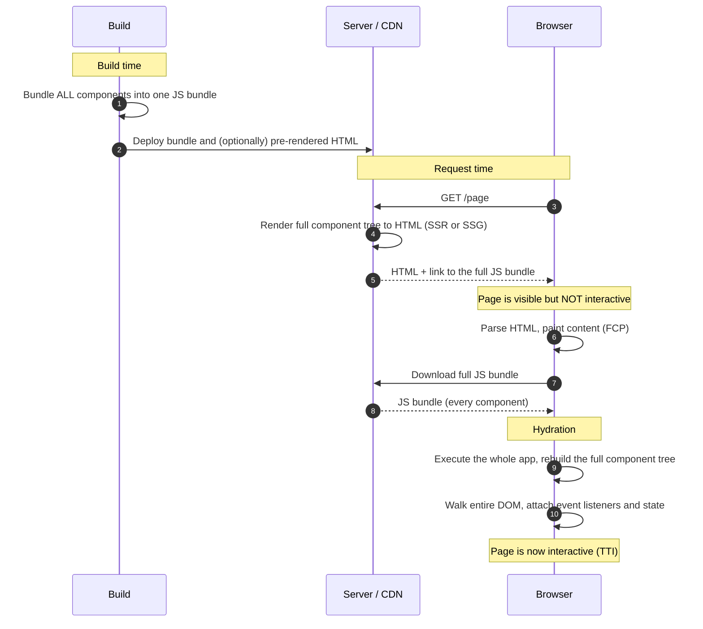
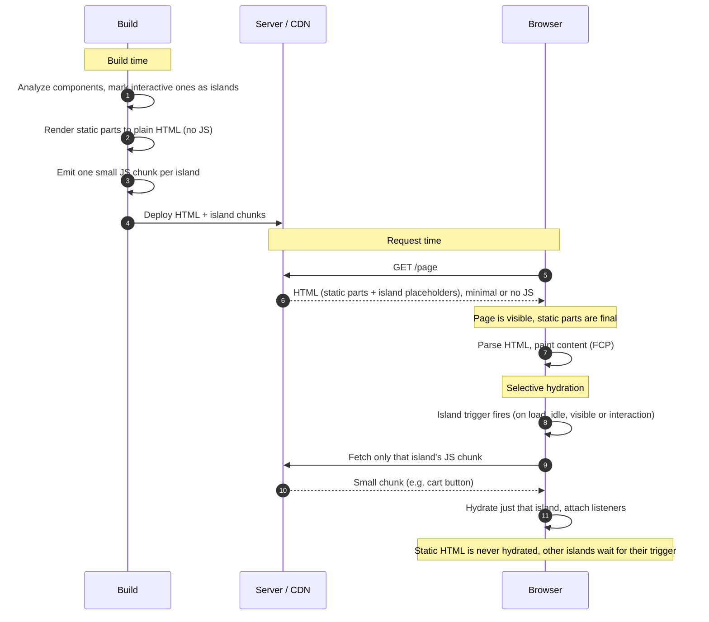

## Hydration
A static HTML page gets turned into a dynamic page from a cleint-side JavaScript application.
This is usually done by attaching event handlers to the nodes of the website.

### Problem:
While the content is displayed immediately, the site needs to wait until the JavaScript has
been fulled loaded and executed. This is especially an issue in large applications,
and is called the "hydration gap".

The solution is...

## Partial Hydration
Render static HTML on the server and define certain placeholders or "slots".
These are dynamic and can be "hydrated" on the client into self-contained widgets, at the same time reusing their
initial HTML code that's still on the server.

This is the so-called "Island Infrastructure"

An Island is an enhanced UI component placed within the static HTML.
They can be split up into Client and Server Islands.
Client: interactive JavaScript component which is being hydrated
Server: a regular component that renders its content server-sided
Both islands are more expensive to run, slower to process and are separate from the rest of the page.